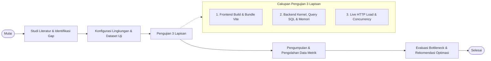
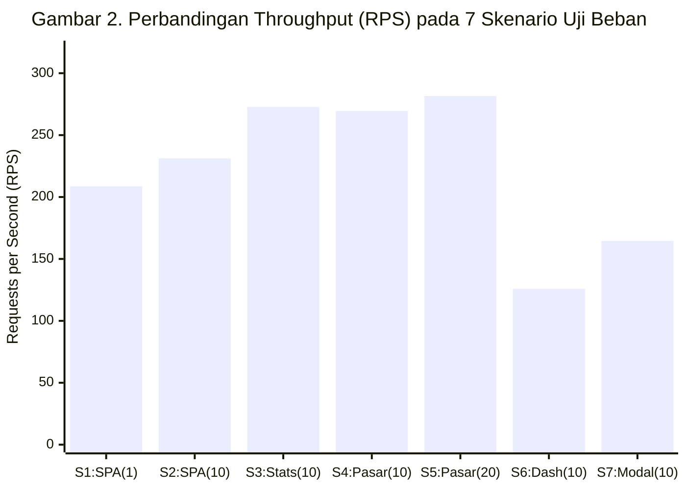
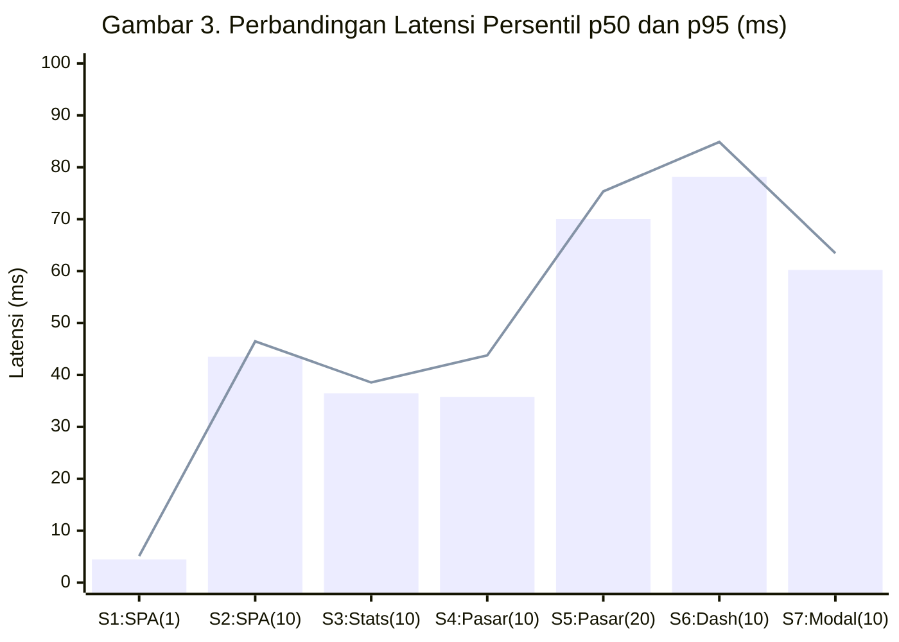

*Sistemasi: Jurnal Sistem Informasi*  
*ISSN: 2302-8149 | e-ISSN: 2540-9719*  
*http://sistemasi.ftik.unisi.ac.id*

---

# Analisa Performa Terhadap Ekosistem Ruang Modal berbasis Web

### *Performance Analysis of Web-Based Ruang Modal Ecosystem*

**¹[Nama Penulis Pertama]\*, ²[Nama Penulis Kedua], ³Rofiuddin**  
¹˒²˒³Program Studi Teknik Informatika / Sistem Informasi, Fakultas Teknik, Universitas Islam Madura  
Jl. Pondok Pesantren Miftahul Ulum Bettet, Kec. Pamekasan, Kab. Pamekasan, Jawa Timur, Indonesia  
*\*e-mail: [email.penulis@uim.ac.id]*

*(received: [DD Month YYYY], revised: [DD Month YYYY], accepted: [DD Month YYYY])*

---

## Abstrak

Transformasi digital pemberdayaan alumni SMA Double Track melalui platform **Ekosistem Ruang Modal**—yang mengintegrasikan layanan Ruang Modal, Ruang Tumbuh, Ruang Pasar, dan Monitoring—menuntut arsitektur web yang andal, aman, dan responsif. Migrasi sistem dari layanan berbasis skrip spreadsheet ke arsitektur *Hybrid Monolith* menggunakan Laravel 13, React.js 18, Vite 8, Redux Toolkit, TanStack Table, TanStack Chart, autentikasi *JSON Web Token* (JWT), serta otorisasi *Role-Based Access Control* (RBAC) Spatie Permission menghadirkan kompleksitas baru pada sisi *frontend* maupun *backend*. Penelitian ini bertujuan menganalisis performa Ekosistem Ruang Modal berbasis web secara menyeluruh (*end-to-end*) mencakup efisiensi *bundle* frontend, profil eksekusi *query* SQL dan memori server, serta ketahanan beban konkuren HTTP. Metode yang digunakan adalah deskriptif kuantitatif eksperimental melalui tiga lapis pengujian: (1) audit *build* produksi Vite 8, (2) *profiling* langsung pada kernel Laravel untuk 13 *endpoint* utama menggunakan *query log* dan pengukuran puncak memori, serta (3) uji beban dan konkurensi HTTP sebanyak 1.200 permintaan pada tingkat konkurensi 1 hingga 20. Kontribusi penelitian ini mengisi kesenjangan penelitian sebelumnya yang umumnya hanya mengevaluasi performa *Client-Side Rendering* (CSR) sisi klien tanpa membedah *bottleneck* query *Object-Relational Mapping* (ORM), autentikasi JWT–RBAC, dan konkurensi API. Hasil pengujian menunjukkan sistem mencapai tingkat kegagalan 0,00% dengan puncak memori server 30 MB, waktu *build* Vite 263 ms, *throughput* publik sebesar 269,43–281,52 *Requests per Second* (RPS), serta *throughput* panel admin terautentikasi JWT sebesar 125,92–164,58 RPS dengan latensi p95 di bawah 85 ms. Meskipun demikian, analisis mendalam mengidentifikasi tiga titik optimasi krusial, yakni 39 *query* SQL pada *endpoint* dashboard analitik, fenomena *N+1 query* (8 *query*) pada daftar pengguna RBAC, serta ukuran *bundle* JavaScript tunggal sebesar 507,57 kB (151,72 kB gzip) yang memerlukan *code splitting* berbasis `React.lazy()`.

**Kata kunci:** *hybrid monolith*, *jwt*, *laravel*, performa web, *react.js*, *ruang modal*.

---

## *Abstract*

*The digital transformation of SMA Double Track alumni empowerment through the Ruang Modal Ecosystem—integrating Ruang Modal (capital facilitation), Ruang Tumbuh (mentoring), Ruang Pasar (marketplace showcase), and Monitoring—demands a reliable, secure, and responsive web architecture. Migrating the platform from a spreadsheet-based script to a Hybrid Monolith architecture built with Laravel 13, React.js 18, Vite 8, Redux Toolkit, TanStack Table, TanStack Chart, JSON Web Token (JWT) authentication, and Spatie Role-Based Access Control (RBAC) introduces new performance considerations across both frontend and backend layers. This study aims to perform an end-to-end performance analysis of the web-based Ruang Modal Ecosystem covering frontend bundle efficiency, server-side SQL query and memory profiling, and HTTP concurrency load resilience. A quantitative descriptive experimental approach was conducted across three evaluation layers: (1) Vite 8 production build and bundle inspection, (2) Laravel HTTP kernel profiling across 13 core endpoints measuring query count, execution time, and peak memory, and (3) live HTTP load and concurrency testing totaling 1,200 requests at concurrency levels from 1 to 20. The primary contribution of this research addresses the gap left by prior studies that focused exclusively on client-side rendering (CSR) metrics without investigating ORM query bottlenecks, JWT–RBAC overhead, and concurrent API throughput. Empirical results demonstrate a 0.00% error rate, 30 MB peak PHP memory usage, 263 ms Vite build time, public API throughput of 269.43–281.52 requests per second (RPS), and JWT-authenticated admin throughput of 125.92–164.58 RPS with p95 latency under 85 ms. Furthermore, deep profiling uncovered three high-impact optimization opportunities: 39 SQL queries on the analytics dashboard endpoint, an N+1 query pattern (8 queries) in RBAC user listing, and a monolithic 507.57 kB (151.72 kB gzipped) JavaScript bundle requiring route-based code splitting.*

***Keywords:*** *hybrid monolith, jwt, laravel, react.js, ruang modal, web performance.*

---

## 1 Pendahuluan

Program SMA Double Track merupakan inisiatif strategis pendidikan menengah di Indonesia yang membekali peserta didik dengan keterampilan vokasional dan kewirausahaan guna menekan angka pengangguran terbuka lulusan sekolah menengah [1], [2]. Berbagai kajian menunjukkan bahwa efektivitas program Double Track sangat ditentukan oleh keberlanjutan pendampingan pasca-kelulusan, penguatan jiwa kewirausahaan, serta kemudahan akses terhadap permodalan dan pasar [3], [4]. Untuk menjawab kebutuhan tersebut, dikembangkan **Ekosistem Alumni SMA Double Track** yang terdiri atas empat pilar layanan utama: **Ruang Modal** (fasilitasi pengajuan peralatan kerja dan modal produksi), **Ruang Tumbuh** (layanan mentoring karier dan usaha), **Ruang Pasar** (etalase digital produk dan jasa alumni terkurasi), serta **Monitoring** (pencatatan perkembangan produktivitas dan omzet alumni).

Pada implementasi awal, layanan tersebut dibangun menggunakan *Google Apps Script* dan *Google Sheets* sebagai basis data. Meskipun praktis untuk purwarupa awal, arsitektur berbasis spreadsheet memiliki keterbatasan serius pada aspek keamanan autentikasi, pemisahan hak akses berbasis peran (*Role-Based Access Control*), skalabilitas kueri relasional, analitik visual, serta ketahanan terhadap akses bersamaan (*concurrency*). Oleh karena itu, sistem dimigrasi ke arsitektur **Hybrid Monolith** modern yang memadukan **Laravel 13** sebagai penyedia *REST API* dan basis data relasional dengan **React.js 18** di dalam direktori `resources/` yang dikompilasi menggunakan **Vite 8**. Ekosistem ini diperkuat oleh **Redux Toolkit** untuk manajemen *state* terpusat, **TanStack Table** untuk tabel data interaktif, **TanStack Chart** untuk visualisasi analitik dashboard, **JWT Auth** untuk autentikasi *stateless*, **Spatie Laravel Permission** untuk kontrol akses granular, serta **Tailwind CSS v4** dengan tata letak bergaya Bootstrap.

Penggabungan berbagai pustaka modern dan mekanisme keamanan berlapis dalam satu aplikasi web *Hybrid Monolith* membawa tantangan tersendiri terhadap performa sistem. Kompleksitas proses *bundling* JavaScript pada sisi klien, overhead eksekusi *Object-Relational Mapping* (ORM) Eloquent, proses *hashing* kata sandi saat login JWT, serta pemeriksaan *permission* RBAC pada setiap permintaan API berpotensi menurunkan kecepatan respons (*response time*) dan kapasitas layanan (*throughput*) apabila tidak dievaluasi secara sistematis [5], [6], [10].

Sejumlah penelitian terdahulu telah mengevaluasi performa aplikasi web modern dari berbagai sudut pandang. Penelitian oleh Cahyono et al. [5] menganalisis kinerja *Client-Side Rendering* (CSR) pada aplikasi *Hybrid Learning Management System* (H-LMS) menggunakan metrik *Core Web Vitals* (*Largest Contentful Paint*, *Total Blocking Time*, dan *Cumulative Layout Shift*) melalui Google Lighthouse pada variasi jaringan 4G dan 5G. Penelitian [6] membandingkan performa CSR pada *static website*, sementara [7] dan [8] mengevaluasi performa rendering arsitektur *microservice*, *serverless*, serta situs web organisasi menggunakan Google Lighthouse dan GTmetrix. Di sisi *backend*, penelitian [10], [11], dan [12] telah membandingkan *response time* dan *throughput* *framework* Laravel terhadap CodeIgniter, Lumen, Spring Boot, dan FrankenPHP menggunakan JMeter serta k6.

Namun demikian, merujuk pada keterbatasan eksplisit yang dikemukakan oleh Cahyono et al. [5], masih terdapat **celah penelitian (*research gap*)** yang signifikan. Pertama, evaluasi performa pada [5] hanya menitikberatkan pada pengujian *lab testing* sisi klien (*frontend rendering*) melalui Google Lighthouse, sehingga belum mengaudit performa lapisan *backend* seperti jumlah eksekusi *query* SQL, potensi *N+1 query* ORM, konsumsi memori server, serta *overhead* autentikasi JWT dan RBAC. Kedua, penelitian [5] belum mengukur ketahanan layanan terhadap beban akses konkuren (*concurrency & load testing*) melalui metrik *throughput* (RPS) dan distribusi latensi persentil (*p50, p95, p99*). Ketiga, [5] secara eksplisit merekomendasikan kajian lanjutan mengenai optimasi eksekusi JavaScript dan *code splitting* pada aplikasi berbasis CSR. Keempat, belum terdapat studi empiris yang melakukan analisa performa *end-to-end* (lapisan *frontend bundle*, *backend query profiling*, dan *HTTP concurrency load*) pada platform pemberdayaan ekonomi alumni vokasional seperti Ekosistem Ruang Modal berbasis *Hybrid Monolith* Laravel–React.

Berdasarkan kesenjangan tersebut, penelitian ini menawarkan kebaruan melalui evaluasi empiris performa *full-stack* terhadap **Ekosistem Ruang Modal berbasis Web** pada tiga lapisan sekaligus: efisiensi *build* dan *bundle* Vite–React, *profiling* *query* SQL dan memori pada kernel Laravel dengan JWT–Spatie RBAC, serta uji beban konkuren HTTP. Tujuan penelitian ini adalah mengukur secara objektif tingkat kecepatan, stabilitas, dan kapasitas layanan Ekosistem Ruang Modal, mengidentifikasi *bottleneck* teknis spesifik pada kode sumber, serta merumuskan rekomendasi optimasi terukur yang siap diterapkan pada lingkungan produksi.

---

## 2 Tinjauan Literatur

### 2.1 Ekosistem Digital Alumni SMA Double Track dan Ruang Modal

Program SMA Double Track dirancang untuk menjembatani kesenjangan kompetensi lulusan sekolah menengah atas yang tidak melanjutkan ke perguruan tinggi agar memiliki kecakapan kerja dan kemandirian berwirausaha [1], [2]. Penelitian oleh Lutfi dan Churiyah [3] serta Mayudho [4] menegaskan bahwa keberhasilan penumbuhan jiwa kewirausahaan peserta didik memerlukan dukungan ekosistem berkelanjutan yang mencakup pelatihan keterampilan, pendampingan (*mentoring*), akses permodalan usaha, dan saluran pemasaran produk. Transformasi layanan tersebut ke dalam platform web terintegrasi seperti Ekosistem Ruang Modal memungkinkan pengajuan bantuan modal, permintaan mentoring, kurasi etalase produk alumni, dan pencatatan *monitoring* omzet berlangsung secara transparan dan terdokumentasi dalam basis data relasional.

### 2.2 Arsitektur Hybrid Monolith, JWT Auth, dan RBAC

Arsitektur *Hybrid Monolith* menggabungkan keunggulan pengelolaan satu repositori terpadu pada *framework* server-side seperti Laravel dengan interaktivitas *Single-Page Application* (SPA) berbasis React.js yang dikompilasi oleh Vite. Pendekatan ini meminimalkan kompleksitas konfigurasi *Cross-Origin Resource Sharing* (CORS) dan *deployment* terpisah, sembari tetap menyediakan antarmuka *REST API* yang bersih. Penelitian [10] dan [11] menunjukkan bahwa Laravel merupakan salah satu *framework* PHP yang kompetitif untuk layanan *REST API*, terutama ketika dikombinasikan dengan *OPcache* dan mekanisme *caching* konfigurasi serta *routing*. Evaluasi lintas bahasa oleh Azzahidi et al. [12] juga menunjukkan bahwa pemilihan runtime dan optimasi arsitektur berdampak langsung pada *throughput* dan penggunaan sumber daya server.

Pada aspek keamanan, penerapan *JSON Web Token* (JWT) standar RFC 7519 yang dipadukan dengan *Role-Based Access Control* (RBAC) memungkinkan verifikasi identitas dan hak akses secara *stateless* tanpa membebani penyimpanan sesi server [13], [14]. Meskipun demikian, studi evaluasi performa keamanan berbasis token [15] menunjukkan bahwa validasi tanda tangan kriptografi JWT, proses *hashing* kata sandi (*bcrypt*), dan pengecekan relasi peran–izin pada basis data tetap memberikan kontribusi terukur terhadap latensi permintaan sehingga perlu diaudit secara empiris.

### 2.3 Evaluasi Performa Web Full-Stack: Bundle Frontend, Query ORM, dan Load Testing

Kualitas pengalaman pengguna (*Quality of Experience* / QoE) pada aplikasi web modern berkorelasi kuat dengan kecepatan pemuatan sumber daya sisi klien maupun kecepatan respons server [9]. Pada sisi *frontend*, aplikasi React berbasis *Client-Side Rendering* (CSR) rentan terhadap pembengkakan ukuran *bundle* JavaScript yang dapat memperlambat waktu render awal dan meningkatkan *Total Blocking Time* (TBT) [5], [6], [16]. Penelitian oleh Aluri [16] dan studi optimasi aplikasi React berbasis *code splitting* serta *lazy loading* [17] membuktikan bahwa pemecahan *bundle* modular mampu memangkas ukuran berkas JavaScript awal hingga lebih dari 50–80% dan mempercepat pemuatan halaman secara signifikan.

Pada sisi *backend*, salah satu akar masalah penurunan performa yang paling umum pada aplikasi berbasis ORM adalah *N+1 query problem* dan agregasi kueri berulang di dalam perulangan (*loop*) [18]. Ketika relasi data tidak dimuat secara *eager loading*, jumlah kueri SQL meningkat secara linear terhadap jumlah baris data, yang berdampak pada lonjakan waktu tunggu basis data dan penurunan *throughput* saat diakses secara bersamaan. Oleh karena itu, pengujian performa komprehensif perlu menggabungkan analisis ukuran *bundle* frontend, *profiling* jumlah dan durasi *query* SQL, serta *load testing* konkuren menggunakan metrik *Requests per Second* (RPS), latensi rata-rata, persentil p50, p95, p99, dan tingkat kegagalan (*error rate*) [10], [11], [12].

---

## 3 Metode Penelitian

Penelitian ini menerapkan pendekatan **deskriptif kuantitatif eksperimental** untuk mengevaluasi performa aplikasi **Ekosistem Alumni SMA Double Track (Ruang Modal)** secara *end-to-end*. Alur tahapan penelitian disajikan pada Gambar 1.

**Gambar 1.** Alur penelitian evaluasi performa Ekosistem Ruang Modal berbasis web.

### 3.1 Studi Literatur

Tahap awal dilakukan dengan mengkaji literatur ilmiah bereputasi nasional (terakreditasi SINTA) maupun internasional (IEEE, MDPI, Elsevier, dan prosiding bereputasi) terkait pemberdayaan alumni SMA Double Track [1]–[4], evaluasi performa *Client-Side Rendering* dan *Core Web Vitals* [5]–[9], *benchmarking* performa *REST API* Laravel [10]–[12], *overhead* autentikasi JWT dan RBAC [13]–[15], serta teknik optimasi *bundle* React dan *query* ORM [16]–[18]. Hasil kajian literatur dari Cahyono et al. [5] dijadikan landasan utama perumusan celah penelitian untuk memperluas evaluasi dari sisi klien semata menuju pengujian *full-stack*.

### 3.2 Arsitektur Sistem dan Konfigurasi Lingkungan Uji

Objek penelitian adalah aplikasi web **Ekosistem Alumni SMA Double Track** yang melayani 4 modul utama (*Ruang Modal*, *Ruang Tumbuh*, *Ruang Pasar*, dan *Monitoring*) serta modul manajemen pengguna dan hak akses (*User & Role RBAC*) dengan total 29 rute API (`/api/*`) dan rute *SPA fallback* (`/`). Basis data diisi dengan data sampel realistis melalui `RolePermissionSeeder` (4 peran: `super-admin`, `admin`, `verifikator`, `petugas-monitoring`; 15 *permission*; 3 akun pengelola) dan `SampleDataSeeder` (data pengajuan modal, permintaan mentoring, produk etalase tayang/moderasi, serta catatan monitoring lintas 6 bulan). Spesifikasi lingkungan pengujian dirinci pada Tabel 1.

**Tabel 1.** Spesifikasi lingkungan dan *stack* teknologi pengujian.

| Komponen | Spesifikasi / Versi |
| :--- | :--- |
| Sistem Operasi | macOS (Apple Silicon) |
| Runtime Backend | PHP 8.4.27 (NTS + Zend OPcache) |
| Framework Backend | Laravel 13.43.0 (`php artisan serve --no-reload`) |
| Autentikasi & Otorisasi | `php-open-source-saver/jwt-auth` v2.10.0 & `spatie/laravel-permission` v8.5.0 |
| Basis Data | SQLite 3 (mode lokal ter-seed) |
| Runtime & Bundler Frontend | Node.js v26.13.1, Vite 8.3.8 (`@vitejs/plugin-react`, `@tailwindcss/vite`) |
| Pustaka UI & State | React 18.3, Redux Toolkit 2.5, TanStack Table 8, TanStack Chart 3, Tailwind CSS v4 |
| Instrumen Uji | `/usr/bin/time`, Laravel `DB::enableQueryLog()` + `hrtime()`, Python `ThreadPoolExecutor` HTTP Benchmarker |

### 3.3 Tahap Pengujian

Pengujian dilaksanakan secara terisolasi pada tiga lapisan arsitektur untuk memisahkan kontribusi beban sisi klien, lapisan aplikasi/basis data, dan antrean jaringan HTTP:

1. **Pengujian Build & Bundle Frontend:** Menjalankan *cold production build* (`npm run build`) dengan pengukuran waktu eksekusi *wall-clock* serta inspeksi jumlah modul, ukuran berkas mentah (*raw*), dan ukuran terkompresi (*gzip*) untuk berkas `manifest.json`, CSS, dan JavaScript.
2. **Profiling Kernel Backend, Query SQL, & Memori:** Menjalankan skrip instrumentasi PHP langsung terhadap `Illuminate\Contracts\Http\Kernel` pada 13 *endpoint* representatif (publik, autentikasi JWT, dan admin RBAC). Setiap *endpoint* diuji sebanyak 20 iterasi (5 iterasi khusus `POST /api/auth/login` karena proses *bcrypt*) dengan pencatatan jumlah *query* SQL, total waktu eksekusi basis data (ms), waktu rata-rata kernel, p50, p95, ukuran *payload* (bytes), serta puncak penggunaan memori (`memory_get_peak_usage(true)`).
3. **Pengujian Beban & Konkurensi HTTP (*Live Load Testing*):** Menjalankan server HTTP aktif (`127.0.0.1:8199`) dan mengirimkan total **1.200 permintaan HTTP** pada 7 skenario pengujian dengan variasi tingkat konkurensi (`c=1`, `c=10`, dan `c=20`), mencakup rute SPA HTML publik, API publik, serta API admin terproteksi *Bearer JWT Token*. Parameter pengujian terangkum pada Tabel 2.

**Tabel 2.** Skenario pengujian beban dan konkurensi HTTP.

| Kode | Skenario | Endpoint Target | Autentikasi | Total Req | Concurrency |
| :---: | :--- | :--- | :---: | :---: | :---: |
| S1 | SPA Root Sekuensial | `GET /` | Publik | 100 | 1 |
| S2 | SPA Root Konkuren | `GET /` | Publik | 200 | 10 |
| S3 | Statistik Publik | `GET /api/public/stats` | Publik | 200 | 10 |
| S4 | Etalase Ruang Pasar (Sedang) | `GET /api/public/pasar` | Publik | 200 | 10 |
| S5 | Etalase Ruang Pasar (Tinggi) | `GET /api/public/pasar` | Publik | 200 | 20 |
| S6 | Dashboard Analitik Admin | `GET /api/admin/dashboard` | JWT + RBAC | 150 | 10 |
| S7 | Daftar Pengajuan Ruang Modal | `GET /api/admin/modal` | JWT + RBAC | 150 | 10 |

### 3.4 Tahap Analisis

Seluruh data hasil pengukuran dikumpulkan dan dianalisis secara deskriptif kuantitatif berdasarkan metrik utama: waktu *build* dan ambang batas ukuran *chunk* Vite (≤ 500 kB), efisiensi jumlah *query* SQL per *endpoint* (identifikasi *N+1 query* dan *loop query*), puncak penggunaan memori server, *throughput* (*Requests per Second* / RPS), distribusi latensi (*average*, *min*, *p50*, *p95*, *p99*, *max*), serta *error rate* (target 0%). Hasil analisis kemudian dibandingkan dengan temuan penelitian terdahulu untuk menyusun matriks prioritas rekomendasi optimasi.

---

## 4 Hasil dan Pembahasan

### 4.1 Hasil Pengujian Build dan Ukuran Bundle Frontend

Hasil pengujian kompilasi produksi *frontend* menggunakan Vite 8 disajikan pada Tabel 3.

**Tabel 3.** Hasil pengujian *build* dan ukuran *bundle* produksi Vite 8.

| Artefak / Metrik | Ukuran Raw | Ukuran Gzip | Keterangan / Evaluasi |
| :--- | :---: | :---: | :--- |
| Waktu Build Internal Vite | 263 ms | — | Sangat cepat (1.904 modul ditransformasi) |
| Waktu Wall-Clock (`npm run build`) | 0,60 detik | — | Efisien untuk alur CI/CD |
| `public/build/manifest.json` | 0,33 kB | 0,17 kB | Optimal |
| `assets/app-DSTqdI5T.css` | 61,49 kB | 12,52 kB | Optimal (Tailwind CSS v4 + gaya Bootstrap) |
| `assets/main-CTpu2Oot.js` | **507,57 kB** | **151,72 kB** | Melewati batas peringatan 500 kB Vite |

Berdasarkan Tabel 3, *bundler* Vite 8 mampu mengompilasi 1.904 modul React, Redux Toolkit, TanStack Table, TanStack Chart, dan Tailwind CSS v4 hanya dalam **263 ms** (total 0,60 detik). Ukuran berkas CSS terkompresi sebesar **12,52 kB gzip** menunjukkan efektivitas mekanisme *tree-shaking* Tailwind CSS v4 meskipun seluruh komponen antarmuka (kartu, formulir, tabel, *badge*, dan *modal*) dirancang mengikuti tata letak Bootstrap.

Namun, berkas JavaScript utama (`main-CTpu2Oot.js`) tercatat sebesar **507,57 kB** (151,72 kB gzip), memicu peringatan ukuran *chunk* Vite (> 500 kB). Analisis ketergantungan modul menunjukkan bahwa hal ini disebabkan oleh pemuatan statis seluruh rute panel admin—khususnya pustaka `react-charts` beserta dependensi `d3-scale`, `d3-shape`, dan `d3-array`—ke dalam satu *entry bundle*. Akibatnya, pengguna publik (alumni yang hanya mengakses formulir Ruang Modal atau Etalase Ruang Pasar) tetap mengunduh dan mem-parsing pustaka grafik admin. Temuan ini mengonfirmasi hasil studi Cahyono et al. [5] dan studi optimasi React [17] bahwa besarnya beban *bundle* JavaScript pada arsitektur CSR menjadi faktor penentu utama latensi *main thread* (TBT) yang dapat ditekan melalui *route-based code splitting* (`React.lazy()` dan `Suspense`).

### 4.2 Hasil Profiling Backend Laravel, Query SQL, dan Memori

Hasil *profiling* eksekusi internal kernel Laravel terhadap 13 *endpoint* utama dirangkum pada Tabel 4 dengan puncak konsumsi memori keseluruhan sebesar **30 MB**.

**Tabel 4.** Hasil *profiling* kernel Laravel, jumlah *query* SQL, dan ukuran *payload*.

| Endpoint | HTTP | Jumlah Query | Waktu DB (ms) | Avg Kernel (ms) | p50 (ms) | p95 (ms) | Payload (Bytes) |
| :--- | :---: | :---: | :---: | :---: | :---: | :---: | :---: |
| `GET /` (SPA Root) | 200 | 3 | 0,70 | 0,60 | 0,55 | 0,74 | 977 |
| `GET /api/public/stats` | 200 | 4 | 0,10 | 0,32 | 0,31 | 0,35 | 61 |
| `GET /api/public/pasar` | 200 | 1 | 0,07 | 0,42 | 0,41 | 0,48 | 2.261 |
| `GET /api/public/pasar?kategori=...` | 200 | 1 | 0,07 | 0,33 | 0,33 | 0,34 | 494 |
| `POST /api/auth/login` | 200 | 4 | 0,24 | **224,24** | 223,73 | 226,08 | 1.106 |
| `GET /api/auth/me` | 200 | 0 | 0,00 | 0,28 | 0,27 | 0,30 | 360 |
| `GET /api/admin/dashboard` | 200 | **39** | 1,48 | 2,33 | 2,25 | 2,78 | 1.807 |
| `GET /api/admin/modal` | 200 | 2 | 0,10 | 0,75 | 0,71 | 0,89 | 3.806 |
| `GET /api/admin/tumbuh` | 200 | 2 | 0,09 | 0,67 | 0,64 | 0,86 | 2.178 |
| `GET /api/admin/pasar` | 200 | 2 | 0,07 | 0,77 | 0,74 | 0,93 | 4.050 |
| `GET /api/admin/monitoring` | 200 | 2 | 0,06 | 0,65 | 0,63 | 0,77 | 1.637 |
| `GET /api/admin/users` | 200 | **8** | 0,33 | 2,57 | 2,52 | 2,96 | 913 |
| `GET /api/admin/roles` | 200 | 3 | 0,10 | 1,53 | 1,47 | 1,73 | 997 |

Dari data Tabel 4 diperoleh empat temuan teknis penting:

1. **Efisiensi Kueri Endpoint Operasional:** Sebagian besar *endpoint* baca publik dan admin (`pasar`, `modal`, `tumbuh`, `monitoring`) hanya membutuhkan **1 hingga 2 *query* SQL** dengan rata-rata waktu proses kernel di bawah **0,80 ms**. Penggunaan *eager loading* (`with('reviewer:id,name')` dan `with('creator:id,name')`) berhasil mencegah *N+1 query* pada modul-modul operasional tersebut.
2. **Overhead Autentikasi JWT vs Login Bcrypt:** Endpoint `GET /api/auth/me` berjalan sangat cepat (**0,28 ms**, 0 *query* tambahan) karena verifikasi token JWT bersifat *stateless* [14]. Sebaliknya, `POST /api/auth/login` membutuhkan rata-rata **224,24 ms** yang hampir seluruhnya berasal dari proses *hashing* `bcrypt` (`BCRYPT_ROUNDS=12`). Perilaku ini tergolong normal dan esensial dari sisi keamanan untuk memperlambat potensi serangan *brute-force*.
3. **Bottleneck Query Berlebih pada Dashboard (39 Query):** Endpoint `GET /api/admin/dashboard` mengeksekusi **39 *query* SQL** per permintaan. Penelusuran kode pada `DashboardController::index()` mengungkapkan bahwa perhitungan tren 6 bulan terakhir untuk 4 modul dilakukan menggunakan perulangan *collection* (`6 bulan × 4 tabel = 24 query COUNT(*) WHERE created_at BETWEEN ...`), ditambah 8 kueri ringkasan KPI, 3 kueri `GROUP BY`, serta kueri pemeriksaan RBAC. Meski pada SQLite lokal hanya memakan 1,48 ms, pada basis data jaringan (MySQL/PostgreSQL) dengan *network round-trip* 1–3 ms per kueri, 39 kueri akan menambah latensi sebesar 40–120 ms per permintaan.
4. **Fenomena N+1 Query pada Manajemen Pengguna (8 Query untuk 3 User):** Pada `RoleUserController::users()`, kueri awal `User::with('roles:id,name')->get()` tidak memuat relasi `roles.permissions` dan `permissions`. Akibatnya, pemanggilan `$u->getAllPermissions()` di dalam fungsi `map()` mengeksekusi kueri tambahan untuk setiap baris pengguna [18]. Jika jumlah akun pengelola meningkat menjadi 100 pengguna, jumlah kueri akan melonjak secara linear melampaui 200 kueri per permintaan.

### 4.3 Hasil Pengujian Beban dan Konkurensi HTTP

Hasil pengujian beban HTTP secara langsung terhadap server aktif pada 7 skenario (total 1.200 permintaan) ditampilkan pada Tabel 5, serta divisualisasikan pada Gambar 2 dan Gambar 3.

**Tabel 5.** Hasil pengujian beban dan konkurensi HTTP (*Live Load Benchmark*).

| Kode | Skenario Uji | Req | Conc. | RPS | Avg (ms) | Min (ms) | p50 (ms) | p95 (ms) | p99 (ms) | Max (ms) | Error |
| :---: | :--- | :---: | :---: | :---: | :---: | :---: | :---: | :---: | :---: | :---: | :---: |
| S1 | SPA Root (`/`) | 100 | 1 | 208,63 | 4,72 | 4,00 | 4,46 | 5,12 | 5,50 | 24,29 | 0,00% |
| S2 | SPA Root (`/`) | 200 | 10 | 231,18 | 42,19 | 5,23 | 43,51 | 46,47 | 47,43 | 48,65 | 0,00% |
| S3 | Public Stats | 200 | 10 | 272,75 | 35,80 | 4,74 | 36,47 | 38,55 | 38,89 | 39,57 | 0,00% |
| S4 | Public Pasar | 200 | 10 | 269,43 | 36,23 | 6,94 | 35,78 | 43,77 | 57,36 | 57,67 | 0,00% |
| S5 | Public Pasar | 200 | 20 | **281,52** | 67,50 | 4,97 | 70,05 | 75,36 | 76,42 | 78,31 | 0,00% |
| S6 | Admin Dashboard (JWT) | 150 | 10 | 125,92 | 76,99 | 15,09 | 78,14 | 84,88 | 86,31 | 87,22 | 0,00% |
| S7 | Admin Modal (JWT) | 150 | 10 | 164,58 | 58,89 | 13,71 | 60,22 | 63,45 | 64,08 | 64,79 | 0,00% |

**Gambar 2.** Perbandingan *throughput* (RPS) pada 7 skenario pengujian beban HTTP.

**Gambar 3.** Perbandingan latensi median (p50, batang) dan persentil ke-95 (p95, garis) dalam milidetik.

Hasil uji beban menunjukkan stabilitas layanan yang sangat baik dengan **0,00% *error rate*** pada seluruh 1.200 permintaan. Pada akses sekuensial (`S1`), halaman utama *Hybrid Monolith* dimuat dengan latensi p95 hanya **5,12 ms**. Ketika konkurensi dinaikkan dari 10 (`S4`) ke 20 (`S5`) pada *endpoint* etalase publik `/api/public/pasar`, *throughput* tetap meningkat dari **269,43 RPS** menjadi **281,52 RPS** dengan latensi p95 **75,36 ms**.

Perbandingan menarik terlihat antara *endpoint* publik (`S4`: 269,43 RPS, p95 43,77 ms) dengan *endpoint* admin terproteksi JWT + Spatie Permission (`S7`: 164,58 RPS, p95 63,45 ms; `S6`: 125,92 RPS, p95 84,88 ms). Penurunan *throughput* sekitar 38,9% pada `S7` merepresentasikan biaya verifikasi JWT, resolusi model pengguna, dan pemeriksaan *middleware permission* Spatie [15]. Sementara itu, penurunan *throughput* lebih lanjut sebesar 23,5% pada `S6` (dibanding `S7`) merupakan dampak langsung dari beban 39 *query* SQL pada `DashboardController`. Seluruh nilai latensi p95 pada kondisi uji tetap berada jauh di bawah ambang batas responsivitas interaktif web (< 100 ms).

### 4.4 Evaluasi Komprehensif, Perbandingan Penelitian Terkait, dan Rekomendasi Optimasi

Perbandingan ruang lingkup dan temuan penelitian ini terhadap studi rujukan utama disajikan pada Tabel 6.

**Tabel 6.** Perbandingan penelitian ini dengan penelitian terdahulu.

| Aspek | Cahyono et al. (2026) [5] | Valentina et al. (2026) [10] | Penelitian Ini (2026) |
| :--- | :--- | :--- | :--- |
| Objek Sistem | Hybrid LMS (Pendidikan Tinggi) | REST API CRUD Eksperimental | Ekosistem Ruang Modal Alumni SMA Double Track |
| Arsitektur | CSR Web App | Laravel 11 vs CodeIgniter 4 | Hybrid Monolith (Laravel 13 + React 18 + Vite 8) |
| Evaluasi Frontend | Core Web Vitals (Lighthouse) | Tidak diuji | Build time & Bundle size (raw/gzip) Vite 8 |
| Audit Query SQL / N+1 | Tidak diuji | Tidak dirinci per-endpoint | Ya (13 endpoint, temuan 39 query & N+1) |
| Evaluasi JWT & RBAC | Tidak diuji | Tidak diuji | Ya (overhead bcrypt, stateless JWT, Spatie RBAC) |
| Load & Concurrency | Tidak diuji (variasi jaringan) | JMeter (hingga 1.000 VU) | 1.200 req (c=1, 10, 20; RPS, p50, p95, p99) |

Berdasarkan seluruh temuan empiris, disusun peta jalan optimasi berbasis prioritas pada Tabel 7 agar sistem siap beroperasi pada skala provinsi dengan ribuan alumni aktif.

**Tabel 7.** Rekomendasi optimasi performa berdasarkan prioritas.

| Prioritas | Lapisan | Akar Masalah | Rekomendasi Teknis | Estimasi Dampak |
| :---: | :--- | :--- | :--- | :--- |
| **P1** | Backend (`DashboardController`) | 39 *query* SQL akibat loop 6 bulan × 4 tabel. | Konsolidasi menjadi 4 kueri agregasi `GROUP BY` bulan + `Cache::remember('admin_dashboard', 60, ...)` dengan invalidasi saat ada mutasi data. | Pengurangan query ~85% (39 → ~6 query); RPS dashboard naik 2×–3×. |
| **P1** | Frontend (`App.jsx` & Vite) | *Bundle* JS tunggal 507,57 kB memuat `react-charts`/`d3` di halaman publik. | Implementasi `React.lazy()` + `<Suspense>` untuk seluruh rute `/admin/*` serta konfigurasi *manual chunking* vendor pada Vite. | Penurunan ukuran *bundle* awal portal publik ~50–60% [17]. |
| **P2** | Backend (`RoleUserController`) | *N+1 query* pada `$u->getAllPermissions()`. | Ubah *eager loading* menjadi `User::with(['roles.permissions', 'permissions'])`. | Jumlah query konstan (3–4 query) tidak bergantung jumlah user [18]. |
| **P2** | Basis Data & API | *Endpoint* admin mengembalikan seluruh baris sekaligus. | Terapkan *server-side pagination* (`->paginate(25)`) dan indeks pada kolom `created_at` saat data > 1.000 baris. | Menjaga stabilitas memori dan *payload* JSON. |
| **P3** | Infrastruktur Produksi | Uji dilakukan pada PHP *built-in server* tanpa *cache* framework. | Aktifkan `php artisan optimize`, gunakan Redis untuk *cache* Spatie Permission, dan jalankan di atas Nginx + PHP-FPM atau Laravel Octane / FrankenPHP [12]. | Peningkatan kapasitas *throughput* produksi 5×–15×. |

---

## 5 Kesimpulan

Berdasarkan hasil pengujian performa tiga lapis terhadap **Ekosistem Ruang Modal berbasis Web** (*Hybrid Monolith* Laravel 13 + React.js 18 + Vite 8 + JWT Auth + Spatie Permission), dapat disimpulkan bahwa sistem memiliki kinerja yang **stabil, cepat, dan andal** dengan tingkat kegagalan **0,00%** dari 1.200 permintaan konkuren dan konsumsi puncak memori server hanya **30 MB**. Pada sisi *frontend*, proses *build* produksi Vite berlangsung sangat cepat (**263 ms**) dengan ukuran CSS efisien (**12,52 kB gzip**). Pada sisi *backend* dan HTTP, *endpoint* publik mencapai *throughput* **269,43–281,52 RPS** (latensi p95 38,55–75,36 ms), sedangkan *endpoint* admin terautentikasi JWT–RBAC mencapai **125,92–164,58 RPS** (latensi p95 63,45–84,88 ms).

Kontribusi utama penelitian ini adalah pembuktian empiris performa *full-stack* yang melengkapi kesenjangan studi *Client-Side Rendering* sebelumnya, sekaligus mengidentifikasi secara presisi tiga titik *bottleneck*: 39 *query* SQL pada dashboard analitik, fenomena *N+1 query* pada daftar pengguna RBAC, serta ukuran *bundle* JavaScript tunggal 507,57 kB. Secara praktis, temuan ini menjadi panduan langsung bagi pengembang aplikasi web pendidikan dan pemberdayaan alumni berbasis *Hybrid Monolith* dalam menjaga keseimbangan antara keamanan RBAC, kekayaan fitur analitik, dan kecepatan akses.

Penelitian ini memiliki keterbatasan karena pengujian beban dijalankan pada lingkungan lokal menggunakan server pengembangan `php artisan serve` dan basis data SQLite 3 tanpa simulasi *real-user monitoring* pada perangkat seluler nyata. Untuk penelitian selanjutnya, disarankan melakukan implementasi dan pengujian komparatif *before–after* atas optimasi *query caching*, *eager loading* RBAC, serta *code splitting* `React.lazy()`, disertai pengujian statistik inferensial pada infrastruktur produksi berbasis Nginx/FrankenPHP, MySQL/PostgreSQL, dan Redis.

---

## Ucapan Terima Kasih

Penulis mengucapkan terima kasih kepada pengelola program **SMA Double Track**, civitas akademika Universitas Islam Madura, serta seluruh pihak yang telah memberikan dukungan, masukan konstruktif, dan fasilitas selama proses perancangan arsitektur, pengembangan aplikasi, serta pelaksanaan pengujian performa dalam penelitian ini.

---

## Referensi

[1] M. Z. Asrori, F. Baskoro, A. Y. Wijaya, and H. Hozairi, “Peningkatan Life Skill Siswa SLTA Melalui Program SMA Double Track Sebagai Upaya Mengurangi Potensi Pengangguran di Jawa Timur,” *Darmabakti: Jurnal Pengabdian dan Pemberdayaan Masyarakat*, vol. 3, no. 1, pp. 1–11, 2022, doi: 10.31102/darmabakti.2022.3.1.1-11.

[2] N. Alfiyah, A. I. Siska, and N. Kareja, “Pelaksanaan Pendidikan Kewirausahaan dalam Program Double Track pada Sekolah Menengah Atas di Kabupaten Banyuwangi,” *Jurnal Pendidikan Ekonomi Undiksha*, vol. 14, no. 2, pp. 230–236, 2022, doi: 10.23887/jjpe.v14i2.52966.

[3] L. Lutfi and M. Churiyah, “Perumusan Strategi Pelatihan ‘SMA Double Track’ untuk Menumbuhkan Jiwa Kewirausahaan Siswa SMA yang Berbasis SWOT,” *Manajemen Kreatif Jurnal (Makreju)*, vol. 1, no. 2, 2023, doi: 10.55606/makreju.v1i2.1295.

[4] D. Mayudho, “Manajemen Program Double Track Mandiri dalam Menumbuhkan Jiwa Kewirausahaan Peserta Didik,” *Jurnal Administrasi dan Manajemen Pendidikan (JAMP)*, vol. 6, no. 3, p. 214, 2023, doi: 10.17977/um027v6i32023p214.

[5] N. P. P. Cahyono, Hoiriyah, A. K. Darmawan, and Rofiuddin, “Analisis Kinerja Client-Side Rendering pada Hybrid LMS menggunakan Metrik Core Web Vitals di berbagai Kondisi Jaringan,” *Sistemasi: Jurnal Sistem Informasi*, vol. 15, no. 7, pp. 2602–2617, 2026.

[6] M. U. Khasanah and I. M. Suartana, “Perbandingan Performa Client Side Rendering pada Implementasi Static Website (Studi Kasus Barokah RentCar),” *Journal of Informatics and Computer Science (JINACS)*, vol. 6, pp. 541–550, 2024.

[7] Y. A. Putra and D. F. Suyatno, “Analisis Performa Rendering Antara Microservice dan Serverless Firebase Architecture pada Aplikasi berbasis Website menggunakan Google Lighthouse,” *Journal of Emerging Information Systems and Business Intelligence (JEISBI)*, vol. 4, no. 2, pp. 1–13, 2023.

[8] A. Prambayun et al., “Analisis Performa Website Karya Usaha menggunakan Google Lighthouse dan GTmetrix,” *Jurnal Komputer dan Informatika*, vol. 10, no. 1, pp. 1–6, 2025.

[9] N. Wehner, M. Seufert, F. Wamser, and T. Hossfeld, “A Vital Improvement? Relating Google’s Core Web Vitals to Actual Web QoE,” in *Proc. 14th Int. Conf. on Quality of Multimedia Experience (QoMEX)*, Lippstadt, Germany, 2022.

[10] P. E. Valentina, D. Handayani, S. R. M. Ibrahim, N. Nanang, and F. M. K. Putra, “Komparasi Performa REST API Laravel 11 dan CodeIgniter 4 menggunakan Metode Eksperimental,” *Jurnal Fasilkom*, vol. 16, no. 1, 2026, doi: 10.37859/jf.v16i1.11274.

[11] M. Faisal and I. K. D. Nuryana, “Comparative Analysis of Laravel, Lumen, Guzzle, Leaf, and Slim Framework Performance on REST API using One Way ANOVA,” *Journal of Emerging Information Systems and Business Intelligence (JEISBI)*, vol. 6, no. 2, 2025, doi: 10.26740/jeisbi.v6i2.66146.

[12] A. S. Azzahidi, B. Wijayanto, and A. Darmawan, “Performance Evaluation of Backend Frameworks for REST API: A Comparative Study of Spring Boot, Flask, Express.js, Laravel FrankenPHP, and Gin,” *Jurnal Teknik Informatika (Jutif)*, vol. 6, no. 4, 2025, doi: 10.52436/1.jutif.2025.6.4.4811.

[13] R. Yulianto, P. Mardiana, R. A. Rahayu, and G. F. Nama, “Performance Comparison Analysis of Springboot and Laravel Frameworks Using API Web Service,” *Jurnal Informatika dan Teknik Elektro Terapan (JITET)*, vol. 12, no. 2, 2024, doi: 10.23960/jitet.v12i2.4141.

[14] “Token-Based Authentication and Role-Based Access Control in Web Applications: Analysis and Implementation of the JWT Standard,” *Scientific Bulletin*, vol. 16, no. 2, pp. 163–168, 2026, doi: 10.54414/EPSQ8389.

[15] N. S. Alshammari et al., “Enhancing Microservices Security with Token-Based Access Control Method,” *Sensors*, vol. 23, no. 6, p. 3363, 2023, doi: 10.3390/s23063363.

[16] Y. S. Aluri, “Frontend Performance Optimization of Large-Scale E-commerce Landing Pages: A Comprehensive Analysis,” *International Journal of Computational and Experimental Science and Engineering (IJCESEN)*, vol. 11, no. 4, pp. 9123–9134, 2025, doi: 10.22399/ijcesen.4372.

[17] “React-based Web Application Performance Optimization Using Code Splitting and Lazy Loading,” in *Proc. 2025 Int. Conf. on Computing and Applied Informatics (ICCAI)*, 2025, doi: 10.1109/ICCAI65301.2025.11279539.

[18] E. Mosul, “Comparative Analysis of Performance and Effectiveness of Laravel and Node.js Frameworks in Web Development,” *Jurnal Informatika dan Teknik Elektro Terapan (JITET)*, vol. 14, no. 2, 2026, doi: 10.23960/jitet.v14i2.9264.
