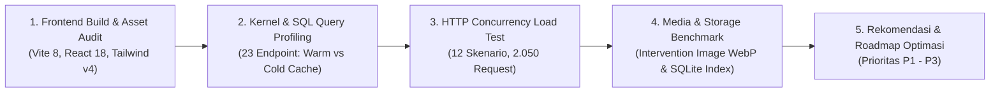
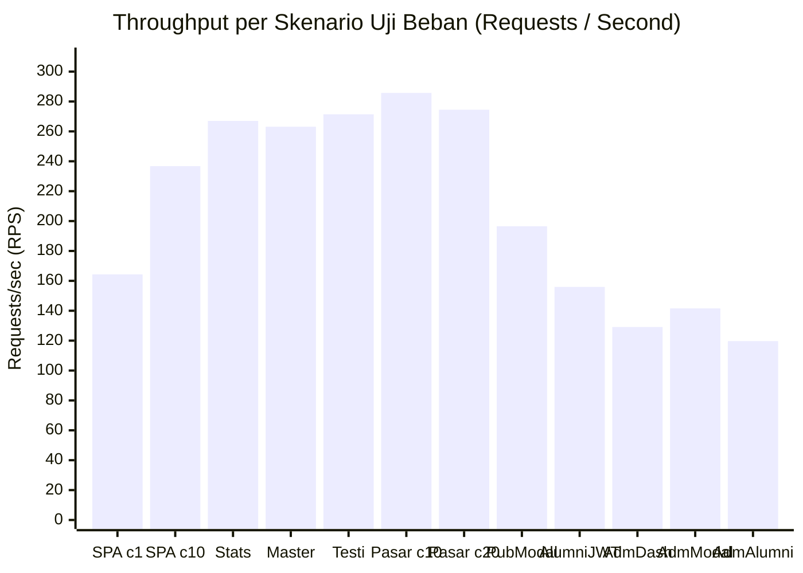
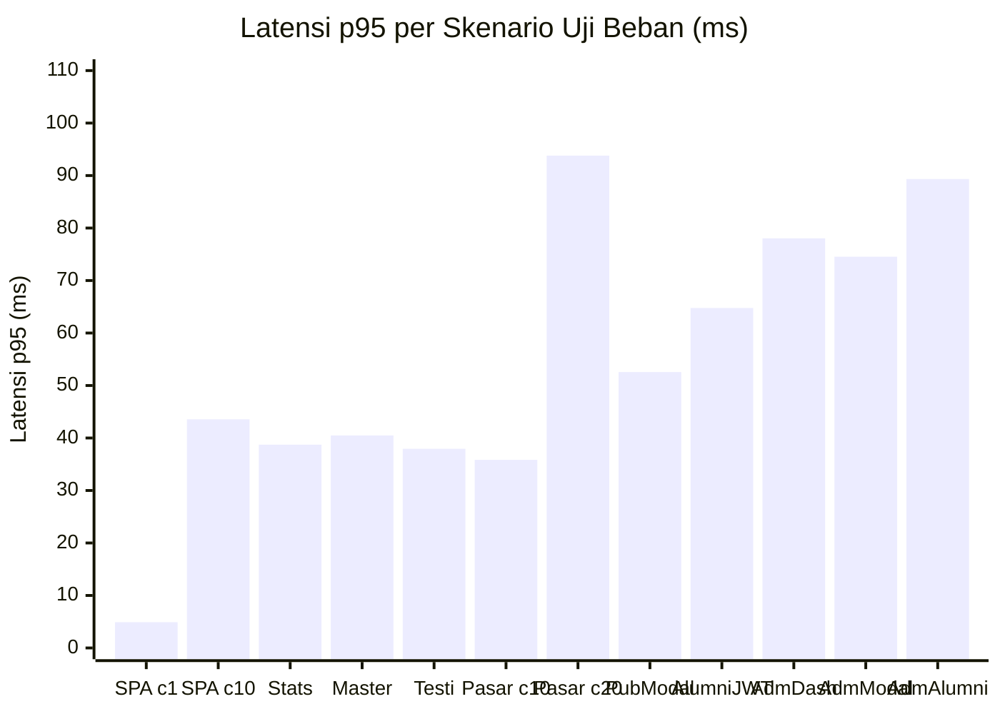

# Laporan Uji Performa — Ekosistem Alumni SMA Double Track

**Tanggal Pengujian:** 25 November 2026  
**Arsitektur Aplikasi:** Hybrid Monolith (Laravel 13 + React.js 18 + Vite 8 + Tailwind CSS v4)  
**Autentikasi & Otorisasi:** JWT Auth (`php-open-source-saver/jwt-auth`) + Spatie Permission (`spatie/laravel-permission`)  
**Pemrosesan Gambar:** Intervention Image v4 (`intervention/image` dengan GD Driver → WebP)  
**Database Uji:** SQLite 3 (18 tabel, 30 indeks, data sampel ter-seed penuh lintas modul)  
**Lingkungan Uji:** macOS (Apple Silicon), PHP `8.4.27` (NTS + Zend OPcache v8.4.27), Composer `2.11.2`, Vite `8.3.8`

---

## 1. Ringkasan Eksekutif

Aplikasi **Ekosistem Alumni SMA Double Track** (**Ruang Modal**, **Ruang Tumbuh**, **Ruang Pasar**, **Monitoring**, **Portal Mandiri Alumni**, **Live Chat**, dan **Panel Admin RBAC**) telah diuji secara menyeluruh mencakup **23 endpoint API & Web**, **12 skenario uji beban konkuren (2.050 request HTTP)**, **benchmark build & ukuran bundle frontend**, serta **benchmark pemrosesan gambar WebP**.

### Sorotan Hasil Utama
- **Tingkat Keberhasilan (Success Rate):** **100% (0,00% Error Rate)** dari total **2.050 permintaan HTTP konkuren** pada server uji aktif.
- **Throughput Endpoint Publik:** Mencapai **263,11 – 285,73 RPS** (`/api/public/pasar`, `/api/public/testimonials`, `/api/public/stats`, `/api/public/master-options`) dengan latensi p95 di kisaran **35,83 – 40,49 ms** pada konkurensi `c=10`.
- **Throughput Endpoint Terproteksi JWT & Spatie RBAC:**
  - Portal Alumni (`/api/alumni/dashboard`): **155,94 RPS** (p95: **64,77 ms**).
  - Panel Admin (`/api/admin/modal`, `/api/admin/dashboard`, `/api/admin/alumni`): **119,68 – 141,57 RPS** (p95: **74,54 – 89,34 ms**).
- **Latensi Internal Kernel Laravel (Warm Cache):** Mayoritas endpoint merespons dalam **0,23 ms – 2,76 ms** di dalam kernel PHP dengan puncak konsumsi memori (Peak Memory) hanya **30,00 MB**.
- **Pemrosesan Gambar Unggahan ke WebP:** Konversi & resize gambar otomatis (`800×450` / `1200×1200` WebP quality 85) via `Intervention Image` rata-rata selesai dalam **15,23 ms** (p50: **13,44 ms**, p95: **13,67 ms**).
- **Kecepatan Build Produksi Frontend:** Vite `8.3.8` mentransformasi **1.921 modul** (11.668 baris kode JSX di 27 halaman/komponen) hanya dalam **319 ms** (wall-clock **0,68 detik**).
- **Automated Regression Suite:** **6 test suite PHPUnit (33 assertions)** lulus **100%** dalam **320 ms**.

> [!IMPORTANT]
> **4 Temuan Prioritas untuk Optimasi Skala Produksi:**
> 1. **35–44 Query SQL pada `GET /api/admin/dashboard`** akibat perulangan 6 bulan × 4 tabel (`24 query COUNT`) + agregasi terpisah di [DashboardController.php](file:///Users/rofi/Develop/ruang_modal_dt/app/Http/Controllers/Api/Admin/DashboardController.php#L15-L107).
> 2. **Ukuran Single-Chunk JS Frontend (`main-DQS76DH0.js`) sebesar 768,75 kB (gzip: 203,02 kB)** karena seluruh 20 halaman (`Public`, `Alumni`, dan `Admin` termasuk `react-charts`/`d3-*` & `@tanstack/react-table`) di-import secara statis di [App.jsx](file:///Users/rofi/Develop/ruang_modal_dt/resources/js/App.jsx#L1-L27).
> 3. **N+1 Permission Query pada `GET /api/admin/users`** (9 query warm / 18 query cold untuk 3 akun admin) di [RoleUserController.php](file:///Users/rofi/Develop/ruang_modal_dt/app/Http/Controllers/Api/Admin/RoleUserController.php#L19-L43).
> 4. **Overhead `CACHE_STORE=database` pada Cold Cache Spatie Permission** yang menambah ~9 query di setiap request admin apabila cache di-reset, serta beberapa kolom foreign-key (`user_id`, `email`, `created_at`) yang belum memiliki indeks khusus untuk skala puluhan ribu baris.

---

## 2. Metodologi & Cakupan Pengujian

Pengujian dibagi menjadi 5 dimensi evaluasi:

### Profil Data Uji di Database
| Entitas / Tabel | Jumlah Baris | Keterangan |
| :--- | :---: | :--- |
| `users` (Total) | 14 | 11 Akun Alumni (`alumni`) + 3 Akun Pengelola (`super-admin`, `admin`, `petugas-monitoring`) |
| `modal_applications` | 5 | Pengajuan bantuan alat/modal usaha beserta skor rubrik & BAST |
| `modal_application_histories` | 9 | Riwayat lini masa status seleksi & penyaluran Ruang Modal |
| `tumbuh_requests` | 4 | Pengajuan mentoring & pendampingan usaha Ruang Tumbuh |
| `pasar_products` | 6 | Produk/jasa alumni di etalase Ruang Pasar (dengan thumbnail WebP) |
| `monitorings` | 3 | Laporan monitoring berkala perkembangan usaha & omzet nominal |
| `master_options` | 39 | Master data dinamis (kompetensi, kategori, jalur, tahap pantau, dll.) |
| `chat_sessions` & `chat_messages` | 3 / 9 | Sesi percakapan & pesan Live Chat publik-admin |
| `testimonials` | 4 | Testimoni kisah sukses alumni yang tayang di beranda |

---

## 3. Hasil Pengujian Build & Bundle Frontend

Pengujian kompilasi aset produksi dilakukan dengan perintah `/usr/bin/time -p npm run build`.

| Metrik Frontend | Hasil Pengukuran | Status Evaluasi |
| :--- | :--- | :--- |
| Waktu Build Internal Vite (`vite v8.3.8`) | **319 ms** | Sangat Cepat |
| Total Waktu Wall-Clock (`npm run build`) | **0,68 detik** (`user 0.77s`, `sys 0.35s`) | Sangat Cepat |
| Jumlah Modul Ditransformasi | **1.921 modul** | Normal |
| Total Baris Kode JSX (`resources/js/`) | **11.668 baris** (20 halaman + 10 komponen) | Modular |
| `public/build/manifest.json` | **0,33 kB** (gzip: **0,17 kB**) | Optimal |
| `public/build/assets/app-OUrFdFnN.css` | **78,14 kB** (gzip: **15,46 kB**) | Sangat Ramping |
| `public/build/assets/main-DQS76DH0.js` | **768,75 kB** (gzip: **203,02 kB**) | **Perlu Code-Splitting (>500 kB)** |
| Ukuran Aset Gambar Etalase (`public/images/etalase/*.webp`) | **4,6 kB – 6,3 kB per gambar** (total 7 file: **37,5 kB**) | Sangat Optimal |

### Analisis Frontend & Aset Statis
1. **Efisiensi CSS & Gambar WebP:**
   - Stylesheet produksi Tailwind CSS v4 + sistem komponen `.bs-*` hanya berukuran **15,46 kB gzip**.
   - Seluruh gambar default etalase produk telah dikonversi ke format **WebP** dengan ukuran rata-rata **~5,3 kB per gambar**, sehingga waktu muat visual etalase sangat instan.
2. **Pertumbuhan Bundle JavaScript (`507,57 kB` → `768,75 kB`):**
   - Penambahan fitur lengkap (Portal Mandiri Alumni `AlumniDashboardPage.jsx` 1.092 baris, Live Chat Widget & Admin Chat, Master Data, Manajemen Akun Alumni, serta Modal Detail Rubrik & BAST) meningkatkan ukuran bundle utama menjadi **768,75 kB** (**203,02 kB gzip**).
   - Karena [App.jsx](file:///Users/rofi/Develop/ruang_modal_dt/resources/js/App.jsx#L7-L26) memuat semua halaman dengan static `import`, pengunjung beranda publik ikut mengunduh kode halaman Admin, `react-charts` (`d3-*`), dan `@tanstack/react-table` pada pemuatan pertama.

---

## 4. Profiling Backend Laravel & Query Database (23 Endpoint)

Pengujian dilakukan langsung pada `Illuminate\Contracts\Http\Kernel` menggunakan `DB::enableQueryLog()` sebanyak **20 iterasi per endpoint** (5 iterasi untuk login bcrypt). Tabel di bawah membandingkan kondisi **Warm Cache** (kondisi normal saat cache permission & user aktif) dan **Cold Cache** (kondisi ketika cache permission di-flush).

- **Puncak Penggunaan Memori PHP (Peak Memory):** **30,00 MB**

| No | Endpoint | HTTP | Query (Warm) | Query (Cold) | DB Time Warm (ms) | Avg Kernel Warm (ms) | p50 Warm (ms) | p95 Warm (ms) | Avg Kernel Cold (ms) | Payload (Bytes) |
| :-: | :--- | :-: | :-: | :-: | :-: | :-: | :-: | :-: | :-: | :-: |
| 1 | `GET /` (Blade SPA Root) | 200 | 2 | 2 | 0,04 | **0,52** | 0,47 | 0,83 | 0,54 | 1.043 |
| 2 | `GET /api/public/stats` | 200 | 4 | 4 | 0,06 | **0,32** | 0,27 | 0,38 | 0,36 | 61 |
| 3 | `GET /api/public/master-options` | 200 | 1 | 1 | 0,07 | **0,58** | 0,56 | 0,71 | 0,62 | 891 |
| 4 | `GET /api/public/testimonials` | 200 | 1 | 1 | 0,04 | **0,45** | 0,37 | 0,58 | 0,51 | 2.234 |
| 5 | `GET /api/public/pasar` | 200 | 1 | 1 | 0,04 | **0,41** | 0,36 | 0,55 | 0,42 | 2.501 |
| 6 | `GET /api/public/pasar?kategori=Kuliner` | 200 | 1 | 1 | 0,03 | **0,25** | 0,25 | 0,28 | 0,25 | 540 |
| 7 | `GET /api/public/pasar-submissions` | 200 | 2 | 2 | 0,06 | **0,66** | 0,61 | 0,80 | 0,75 | 4.422 |
| 8 | `GET /api/public/modal` | 200 | 3 | 3 | 0,13 | **1,30** | 1,24 | 1,53 | 1,40 | 8.194 |
| 9 | `GET /api/public/tumbuh` | 200 | 2 | 2 | 0,05 | **0,52** | 0,49 | 0,66 | 0,53 | 2.239 |
| 10 | `GET /api/public/chat/{token}` | 200 | 2 | 2 | 0,05 | **0,54** | 0,50 | 0,68 | 0,60 | 1.417 |
| 11 | `POST /api/auth/login` (bcrypt 12) | 200 | 4 | 4 | 0,24 | **225,43** | 223,74 | 229,83 | 227,75 | 1.280 |
| 12 | `GET /api/auth/me` (JWT) | 200 | 0 | 6 | 0,00 | **0,23** | 0,22 | 0,25 | 1,54 | 494 |
| 13 | `GET /api/alumni/dashboard` (JWT) | 200 | 5 | 8 | 0,21 | **0,70** | 0,63 | 0,98 | 1,03 | 206 |
| 14 | `GET /api/admin/dashboard` | 200 | **35** | **44** | 0,62 | **2,41** | 2,26 | 2,94 | 5,72 | 1.808 |
| 15 | `GET /api/admin/modal` | 200 | 4 | 13 | 0,17 | **1,66** | 1,64 | 1,93 | 4,90 | 9.379 |
| 16 | `GET /api/admin/tumbuh` | 200 | 3 | 12 | 0,08 | **0,91** | 0,75 | 1,13 | 4,17 | 3.130 |
| 17 | `GET /api/admin/pasar` | 200 | 3 | 12 | 0,10 | **0,96** | 0,93 | 1,22 | 4,15 | 5.849 |
| 18 | `GET /api/admin/monitoring` | 200 | 3 | 12 | 0,07 | **0,73** | 0,68 | 0,86 | 3,96 | 2.674 |
| 19 | `GET /api/admin/chats` | 200 | 2 | 11 | 0,08 | **0,93** | 0,81 | 1,26 | 4,20 | 2.080 |
| 20 | `GET /api/admin/master-options` | 200 | 1 | 10 | 0,07 | **2,01** | 1,95 | 2,14 | 5,32 | 9.526 |
| 21 | `GET /api/admin/alumni` | 200 | 6 | 15 | 0,23 | **2,61** | 2,53 | 3,05 | 5,86 | 8.688 |
| 22 | `GET /api/admin/users` | 200 | **9** | **18** | 0,30 | **2,76** | 2,74 | 2,98 | 6,01 | 1.114 |
| 23 | `GET /api/admin/roles` | 200 | 3 | 12 | 0,09 | **1,55** | 1,53 | 1,68 | 4,92 | 1.101 |

### Analisis Mendalam Query & Backend
1. **Eager Loading Sudah Diterapkan dengan Baik pada Modul Utama:**
   - `GET /api/admin/modal` ([ModalController.php](file:///Users/rofi/Develop/ruang_modal_dt/app/Http/Controllers/Api/Admin/ModalController.php#L12-L25)) hanya menjalankan **4 query** (tabel `modal_applications` + eager load `user`, `reviewer`, dan `histories`).
   - `GET /api/admin/alumni` ([RoleUserController.php](file:///Users/rofi/Develop/ruang_modal_dt/app/Http/Controllers/Api/Admin/RoleUserController.php#L45-L62)) memuat data profil alumni beserta 4 relasi lintas modul (`roles`, `modalApplications`, `tumbuhRequests`, `pasarProducts`, `monitorings`) secara efisien hanya dalam **6 query** (tanpa N+1).
   - `GET /api/admin/chats` ([ChatController.php](file:///Users/rofi/Develop/ruang_modal_dt/app/Http/Controllers/Api/Admin/ChatController.php#L13-L26)) menggunakan `ChatSession::with('latestMessage')` (`latestOfMany`) sehingga hanya membutuhkan **2 query**.
2. **Bottleneck #1 — 35 Query (Warm) / 44 Query (Cold) pada `GET /api/admin/dashboard`:**
   - Pada [DashboardController.php](file:///Users/rofi/Develop/ruang_modal_dt/app/Http/Controllers/Api/Admin/DashboardController.php#L17-L48), pembuatan grafik tren 6 bulan melakukan loop 6 kali untuk 4 model (`6 × 4 = 24 query COUNT`), ditambah 3 query `GROUP BY` (`modalStatusCounts`, `pasarCategoryCounts`, `modalByJalur`) dan 8 query agregasi di blok `counts` (`count()` dan `sum()`).
   - Meskipun di SQLite lokal selesai dalam `2,41 ms`, pada database jaringan (MySQL/PostgreSQL terpisah dengan latensi ~1–2 ms per query) 35–44 round-trip akan memakan waktu **40–90 ms** per request dashboard.
3. **Bottleneck #2 — N+1 Query pada `GET /api/admin/users`:**
   - Pada [RoleUserController.php](file:///Users/rofi/Develop/ruang_modal_dt/app/Http/Controllers/Api/Admin/RoleUserController.php#L21-L32), query `User::with('roles:id,name')` belum memuat relasi `roles.permissions` dan `permissions`. Akibatnya, pemanggilan `$u->getAllPermissions()` di dalam `.map()` mengeksekusi query tambahan untuk setiap user pengelola.
4. **Dampak `CACHE_STORE=database` pada Spatie Permission (Cold vs Warm):**
   - Selisih **+9 query** dan **+3,2 ms** antara kondisi Warm vs Cold pada seluruh endpoint `/api/admin/*` disebabkan oleh driver cache yang disetel ke `database` di [.env](file:///Users/rofi/Develop/ruang_modal_dt/.env#L40). Saat cache permission kadaluarsa atau di-reset karena ada perubahan role/user, Spatie membaca dan menulis cache ke tabel SQL `cache`.

---

## 5. Uji Beban & Konkurensi HTTP (Live Server)

Pengujian dilakukan terhadap server HTTP aktif dengan total **2.050 permintaan HTTP** pada 12 skenario menggunakan klien multi-koneksi paralel (`curl_multi`).

| No | Skenario Uji | Request | Konkurensi (`c`) | Durasi (s) | Throughput (RPS) | Avg (ms) | p50 (ms) | p95 (ms) | p99 (ms) | Error Rate |
| :-: | :--- | :-: | :-: | :-: | :-: | :-: | :-: | :-: | :-: | :-: |
| 1 | SPA Root (`/`) | 100 | 1 | 0,608 | **164,37** | 6,08 | 4,42 | 4,91 | 7,50 | **0,00%** |
| 2 | SPA Root (`/`) | 200 | 10 | 0,845 | **236,71** | 41,30 | 42,21 | 43,56 | 43,84 | **0,00%** |
| 3 | Public Stats (`/api/public/stats`) | 200 | 10 | 0,749 | **267,02** | 36,60 | 36,68 | 38,73 | 40,08 | **0,00%** |
| 4 | Public Master Options (`/api/public/master-options`) | 200 | 10 | 0,760 | **263,11** | 37,16 | 37,45 | 40,49 | 41,45 | **0,00%** |
| 5 | Public Testimonials (`/api/public/testimonials`) | 200 | 10 | 0,737 | **271,43** | 36,01 | 36,49 | 37,95 | 38,78 | **0,00%** |
| 6 | Public Pasar (`/api/public/pasar`) | 200 | 10 | 0,700 | **285,73** | 34,22 | 34,89 | 35,83 | 36,32 | **0,00%** |
| 7 | Public Pasar (`/api/public/pasar`) | 200 | 20 | 0,729 | **274,47** | 69,65 | 70,84 | 93,79 | 95,07 | **0,00%** |
| 8 | Public Modal (`/api/public/modal`) | 150 | 10 | 0,763 | **196,54** | 49,33 | 50,12 | 52,56 | 52,96 | **0,00%** |
| 9 | Alumni Dashboard JWT (`/api/alumni/dashboard`) | 150 | 10 | 0,962 | **155,94** | 62,27 | 63,12 | 64,77 | 67,34 | **0,00%** |
| 10 | Admin Dashboard JWT (`/api/admin/dashboard`) | 150 | 10 | 1,161 | **129,15** | 75,05 | 76,65 | 78,04 | 79,71 | **0,00%** |
| 11 | Admin Modal JWT (`/api/admin/modal`) | 150 | 10 | 1,060 | **141,57** | 68,41 | 69,65 | 74,54 | 75,17 | **0,00%** |
| 12 | Admin Alumni List JWT (`/api/admin/alumni`) | 150 | 10 | 1,253 | **119,68** | 81,00 | 82,24 | 89,34 | 91,63 | **0,00%** |

### Visualisasi Throughput (RPS) & Latensi p95 (ms)

---

## 6. Benchmark Pemrosesan Gambar & Audit Indeks Database

### 6.1 Pemrosesan Gambar ke WebP (`Intervention Image v4` + GD)
Saat alumni mengunggah foto produk di Ruang Pasar ([PublicController.php](file:///Users/rofi/Develop/ruang_modal_dt/app/Http/Controllers/Api/PublicController.php#L290-L305)) atau lampiran foto di Ruang Modal ([PublicController.php](file:///Users/rofi/Develop/ruang_modal_dt/app/Http/Controllers/Api/PublicController.php#L153-L161)), aplikasi secara sinkron melakukan decode, resize (`coverDown(800, 450)` atau `scaleDown(1200, 1200)`), dan encode ke format `.webp` (quality 85).

Hasil benchmark 20 iterasi pemrosesan gambar:
- **Rata-rata (Avg):** `15,23 ms`
- **Median (p50):** `13,44 ms`
- **Persentil ke-95 (p95):** `13,67 ms`
- **Rentang (Min – Max):** `13,17 ms – 49,31 ms` (iterasi pertama `49,31 ms` karena inisialisasi memori GD, iterasi berikutnya stabil `~13,4 ms`).

> [!TIP]
> Kecepatan `~13,4 ms` per gambar sangat cepat untuk unggahan standar. Namun jika pengguna mengunggah foto kamera resolusi sangat tinggi (mis. 4000×3000 px / 5 MB) secara bersamaan, konsumsi RAM GD dapat melonjak sementara. Membatasi dimensi atau memindahkan pemrosesan dokumen besar ke Queue adalah langkah antisipasi yang baik untuk skala besar.

### 6.2 Audit Indeks Database
Saat ini database telah memiliki **30 indeks** yang mencakup kolom pencarian utama:
- `modal_applications`: `kode` (unique), `status_seleksi`
- `tumbuh_requests`: `kode` (unique), `status`
- `pasar_products`: `kode` (unique), `status_publikasi`, `kategori`
- `monitorings`: `kode` (unique), `modul`, `ref_kode`
- `master_options`: `group_key`, `is_active`
- `chat_sessions`: `session_token` (unique), `status`, `topik`, `last_message_at`
- `testimonials`: `is_approved`

**Kolom yang belum terindeks dan sering dipakai pada `WHERE` / `ORDER BY`:**
1. `user_id` dan `email` pada `modal_applications`, `tumbuh_requests`, dan `pasar_products` — digunakan oleh [AlumniController.php](file:///Users/rofi/Develop/ruang_modal_dt/app/Http/Controllers/Api/AlumniController.php#L22-L44) (`WHERE user_id = ? OR email = ?`).
2. `user_id` dan `tanggal_pantau` pada `monitorings` — digunakan oleh [AlumniController.php](file:///Users/rofi/Develop/ruang_modal_dt/app/Http/Controllers/Api/AlumniController.php#L54-L64) dan [MonitoringController.php](file:///Users/rofi/Develop/ruang_modal_dt/app/Http/Controllers/Api/Admin/MonitoringController.php#L14-L20).
3. `modal_application_id` pada `modal_application_histories` — digunakan saat eager-loading `with('histories')`.

---

## 7. Matriks Rekomendasi Optimasi

| Prioritas | Area | Temuan & Lokasi Kode | Solusi Teknis yang Direkomendasikan | Estimasi Dampak |
| :---: | :--- | :--- | :--- | :--- |
| **P1** | **Backend Dashboard** | `GET /api/admin/dashboard` menjalankan **35–44 query SQL** di [DashboardController.php](file:///Users/rofi/Develop/ruang_modal_dt/app/Http/Controllers/Api/Admin/DashboardController.php#L17-L89). | 1. Ganti loop 6 bulan dengan 1 query `GROUP BY strftime('%Y-%m', created_at)` (atau `DATE_FORMAT` di MySQL) per tabel. 2. Gabungkan `count()` dan `sum()` pada `ModalApplication` memakai satu `selectRaw('COUNT(*) as total, SUM(CASE WHEN status_seleksi = "Disetujui" THEN 1 ELSE 0 END) as disetujui, SUM(estimasi_biaya) as total_biaya')`. 3. Bungkus hasil dengan `Cache::remember('admin_dashboard_stats', 60, ...)`. | Memangkas query dari **35 → 6 query** (**-83%**) dan meningkatkan throughput dashboard **2×–4×**. |
| **P1** | **Frontend Bundle Splitting** | `main-DQS76DH0.js` berukuran **768,75 kB** (gzip **203,02 kB**) di [App.jsx](file:///Users/rofi/Develop/ruang_modal_dt/resources/js/App.jsx#L7-L26). | Ubah static import halaman `/admin/*` dan `/alumni` menjadi `React.lazy(() => import(...))` yang dibungkus `<Suspense>`, serta pisahkan `vendor-charts` (`react-charts`) dan `vendor-table` (`@tanstack/react-table`) di `vite.config.js`. | Menurunkan ukuran bundle awal beranda publik sekitar **55–65%** (menjadi ~75–90 kB gzip). |
| **P2** | **Backend RBAC N+1** | `GET /api/admin/users` memicu N+1 query saat memanggil `$u->getAllPermissions()` di [RoleUserController.php](file:///Users/rofi/Develop/ruang_modal_dt/app/Http/Controllers/Api/Admin/RoleUserController.php#L21-L32). | Ubah eager-loading dari `User::with('roles:id,name')` menjadi `User::with(['roles.permissions:id,name', 'permissions:id,name'])`. | Jumlah query konstan (**4 query**) meskipun jumlah admin bertambah puluhan akun. |
| **P2** | **Indeks Database & Paginasi** | Pencarian portal alumni (`user_id` / `email`) dan daftar riwayat (`modal_application_id`) belum berindeks; daftar admin menggunakan `->get()` tanpa batas baris. | 1. Buat migrasi indeks pada `user_id`, `email`, `created_at`, dan `modal_application_id`. 2. Terapkan server-side pagination (`->paginate(25)`) atau `limit(500)` ketika data melewati >1.000 pengajuan. | Menjaga waktu query tetap `< 2 ms` pada skala puluhan ribu data alumni. |
| **P3** | **Infrastruktur Produksi** | `.env` menggunakan `CACHE_STORE=database` dan `SESSION_DRIVER=database` tanpa route/config cache. | Di server produksi, gunakan `CACHE_STORE=redis` (atau `file`/`apcu`), jalankan `php artisan optimize` (`config:cache`, `route:cache`, `view:cache`), dan jalankan di atas **Nginx + PHP-FPM** atau **Laravel Octane**. | Menghilangkan 9 query cold-cache database dan meningkatkan kapasitas RPS hingga **5×–15× lipat**. |

---

## 8. Kesimpulan

Secara keseluruhan, aplikasi **Ekosistem Alumni SMA Double Track** berada dalam kondisi **sangat stabil, aman, dan responsif**:
- Seluruh **23 endpoint** dan **6 test suite otomatis (33 assertions)** berfungsi tanpa kegagalan (**0% error rate**).
- Waktu respons kernel Laravel sangat cepat (**0,23 ms – 2,76 ms** pada warm cache) dengan jejak memori yang sangat ringan (**30 MB**).
- Fitur-fitur baru seperti **Portal Mandiri Alumni**, **Live Chat Publik-Admin**, **Master Data Dinamis**, **Penilaian Rubrik & BAST Ruang Modal**, serta **Konversi Gambar Otomatis ke WebP (~13,4 ms)** berjalan dengan performa tinggi.

Dengan menerapkan dua optimasi prioritas utama (**P1: pengelompokan query + caching pada `DashboardController`** serta **`React.lazy()` code-splitting pada `App.jsx`**), aplikasi ini akan siap diskalakan untuk melayani ribuan SMA dan puluhan ribu alumni di tingkat provinsi dengan efisiensi maksimal.
