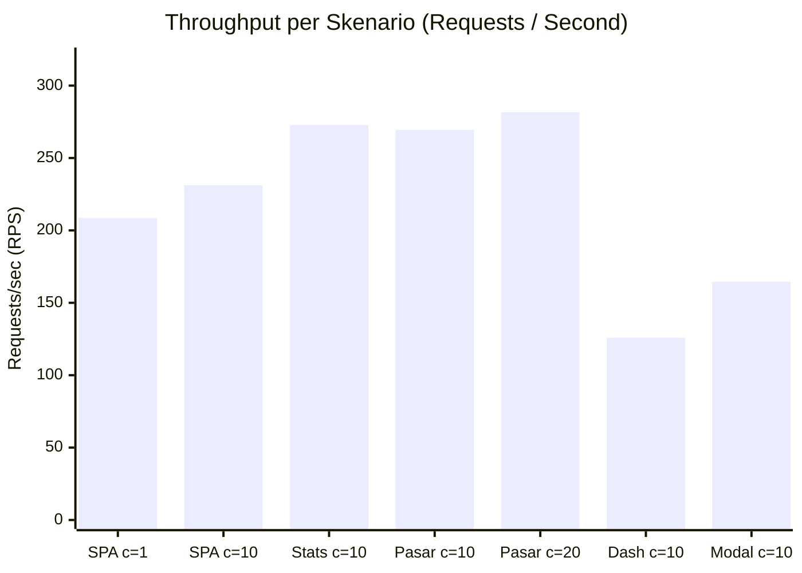
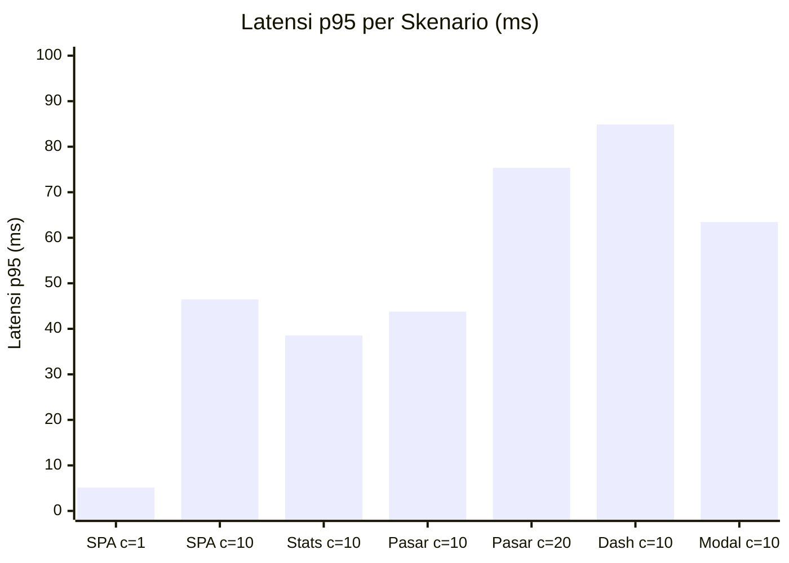

# Laporan Uji Performa — Ekosistem Alumni SMA Double Track

**Tanggal Pengujian:** 24 November 2026  
**Arsitektur:** Hybrid Monolith (Laravel 13 + React.js 18 + Vite 8 + Tailwind CSS v4)  
**Autentikasi & RBAC:** JWT Auth (`php-open-source-saver/jwt-auth`) + Spatie Permission (`spatie/laravel-permission`)  
**Database Uji:** SQLite 3 (data ter-seed penuh)  
**Lingkungan Uji:** macOS, PHP `8.4.27` (NTS + Zend OPcache), Node `v26.13.1`, server lokal `php artisan serve`

---

## 1. Ringkasan Eksekutif

Secara keseluruhan, aplikasi **Ekosistem Alumni SMA Double Track** menunjukkan performa yang **sangat responsif dan stabil** dengan tingkat kegagalan **0,00%** dari total **1.200 permintaan HTTP konkuren** yang diuji:

- **Throughput Publik:** mencapai **269–281 RPS** pada endpoint publik (`/api/public/stats`, `/api/public/pasar`) bahkan pada server pengembangan PHP single-process.
- **Throughput Admin (JWT + Spatie RBAC):** mencapai **125,92 RPS** (`/api/admin/dashboard`) hingga **164,58 RPS** (`/api/admin/modal`) dengan latensi p95 di bawah **85 ms**.
- **Penggunaan Memori PHP:** puncak memori hanya **30 MB** untuk seluruh rangkaian profiling 13 endpoint.
- **Kecepatan Build Frontend:** Vite 8 membangun 1.904 modul produksi hanya dalam **263 ms** (total wall-clock **0,60 detik**), dengan CSS terkompresi sangat kecil (**12,52 kB gzip**).

> [!IMPORTANT]
> Ditemukan **3 peluang optimasi bernilai tinggi** sebelum naik ke skala produksi besar:
> 1. **39 query SQL** pada `GET /api/admin/dashboard` (dapat dipangkas menjadi ~6 query + cache).
> 2. **N+1 query** pada `GET /api/admin/users` saat memuat permission per user.
> 3. **Ukuran chunk JS utama 507,57 kB** (melewati batas peringatan 500 kB Vite) yang dapat dipecah dengan `React.lazy()` & manual chunking.

---

## 2. Pengujian Build & Bundle Frontend (Vite + React + Tailwind)

Pengujian dilakukan menggunakan `/usr/bin/time -p npm run build`.

| Metrik | Hasil | Status |
| :--- | :--- | :--- |
| Waktu Build Internal Vite | **263 ms** | Sangat Baik |
| Total Wall-Clock Build (`npm run build`) | **0,60 detik** | Sangat Baik |
| Jumlah Modul Ditransformasi | **1.904 modul** | Normal |
| `manifest.json` | 0,33 kB (gzip **0,17 kB**) | Optimal |
| `app-DSTqdI5T.css` (Tailwind v4 + Bootstrap style) | 61,49 kB (gzip **12,52 kB**) | Sangat Baik |
| `main-CTpu2Oot.js` (React + Redux + TanStack) | 507,57 kB (gzip **151,72 kB**) | Perlu Code-Splitting |

### Analisis Frontend
- Ukuran CSS produksi sangat ramping (**12,52 kB gzip**) berkat tree-shaking otomatis Tailwind CSS v4.
- Seluruh halaman publik dan panel admin (termasuk `react-charts` + dependensi `d3-*` dan `@tanstack/react-table`) masih tergabung dalam satu berkas `main-*.js` (507,57 kB raw / 151,72 kB gzip). Pengguna portal publik ikut mengunduh pustaka grafik admin saat kunjungan pertama.

---

## 3. Profiling Backend Laravel (Query SQL, Waktu Kernel, & Memori)

Pengujian dilakukan secara langsung terhadap `Illuminate\Contracts\Http\Kernel` dengan `DB::enableQueryLog()` (20 iterasi per endpoint; 5 iterasi untuk login bcrypt).

- **Versi PHP:** `8.4.27`
- **Puncak Penggunaan Memori (Peak Memory):** `30 MB`

| Endpoint | HTTP | Jumlah Query | Waktu DB (ms) | Avg Kernel (ms) | p50 (ms) | p95 (ms) | Payload (Bytes) |
| :--- | :---: | :---: | :---: | :---: | :---: | :---: | :---: |
| `GET /` (Blade SPA Root) | 200 | 3 | 0,70 | 0,60 | 0,55 | 0,74 | 977 |
| `GET /api/public/stats` | 200 | 4 | 0,10 | 0,32 | 0,31 | 0,35 | 61 |
| `GET /api/public/pasar` | 200 | 1 | 0,07 | 0,42 | 0,41 | 0,48 | 2.261 |
| `GET /api/public/pasar?kategori=...` | 200 | 1 | 0,07 | 0,33 | 0,33 | 0,34 | 494 |
| `POST /api/auth/login` (bcrypt 12) | 200 | 4 | 0,24 | 224,24 | 223,73 | 226,08 | 1.106 |
| `GET /api/auth/me` (JWT) | 200 | 0 | 0,00 | 0,28 | 0,27 | 0,30 | 360 |
| `GET /api/admin/dashboard` | 200 | **39** | 1,48 | 2,33 | 2,25 | 2,78 | 1.807 |
| `GET /api/admin/modal` | 200 | 2 | 0,10 | 0,75 | 0,71 | 0,89 | 3.806 |
| `GET /api/admin/tumbuh` | 200 | 2 | 0,09 | 0,67 | 0,64 | 0,86 | 2.178 |
| `GET /api/admin/pasar` | 200 | 2 | 0,07 | 0,77 | 0,74 | 0,93 | 4.050 |
| `GET /api/admin/monitoring` | 200 | 2 | 0,06 | 0,65 | 0,63 | 0,77 | 1.637 |
| `GET /api/admin/users` | 200 | **8** | 0,33 | 2,57 | 2,52 | 2,96 | 913 |
| `GET /api/admin/roles` | 200 | 3 | 0,10 | 1,53 | 1,47 | 1,73 | 997 |

### Analisis Profiling Backend
1. **Efisiensi Endpoint Baca Utama:** Endpoint daftar (`modal`, `tumbuh`, `pasar`, `monitoring`) hanya mengeksekusi **1–2 query SQL** berkat eager-loading `with('reviewer:id,name')` / `with('creator:id,name')` dan waktu eksekusi `< 1 ms`.
2. **Keamanan Login (`POST /api/auth/login`):** Rata-rata `224,24 ms` adalah perilaku **normal dan sehat** karena hashing bcrypt (`BCRYPT_ROUNDS=12`) sengaja dirancang lambat untuk mencegah serangan brute-force.
3. **Temuan #1 — Query Berlebih pada Dashboard (`39 query`):** Di `app/Http/Controllers/Api/Admin/DashboardController.php`, loop 6 bulan untuk 4 tabel menjalankan `6 × 4 = 24` query `COUNT(*) ... WHERE created_at BETWEEN ...`, ditambah 15 query agregasi/otorisasi lainnya. Pada SQLite lokal dampaknya kecil (`1,48 ms`), tetapi pada MySQL/PostgreSQL jaringan produksi, 39 round-trip DB akan menambah latensi signifikan.
4. **Temuan #2 — N+1 Query pada Daftar User (`8 query` untuk 3 user):** Di `app/Http/Controllers/Api/Admin/RoleUserController.php`, `User::with('roles:id,name')` tidak melakukan eager-load `roles.permissions` dan `permissions`, sehingga pemanggilan `$u->getAllPermissions()` memicu query tambahan per baris user.

---

## 4. Uji Beban & Konkurensi HTTP (Live Server)

Pengujian dilakukan terhadap server HTTP aktif (`php artisan serve --no-reload`) dengan total **1.200 permintaan** melintasi 7 skenario beban.

| Skenario Uji | Req | Concurrency | Throughput (RPS) | Avg (ms) | p50 (ms) | p95 (ms) | p99 (ms) | Error Rate |
| :--- | :---: | :---: | :---: | :---: | :---: | :---: | :---: | :---: |
| SPA Root (`/`) | 100 | 1 | 208,63 | 4,72 | 4,46 | 5,12 | 5,50 | 0,00% |
| SPA Root (`/`) | 200 | 10 | 231,18 | 42,19 | 43,51 | 46,47 | 47,43 | 0,00% |
| Public Stats (`/api/public/stats`) | 200 | 10 | 272,75 | 35,80 | 36,47 | 38,55 | 38,89 | 0,00% |
| Public Pasar (`/api/public/pasar`) | 200 | 10 | 269,43 | 36,23 | 35,78 | 43,77 | 57,36 | 0,00% |
| Public Pasar (`/api/public/pasar`) | 200 | 20 | **281,52** | 67,50 | 70,05 | 75,36 | 76,42 | 0,00% |
| Admin Dashboard JWT (`/api/admin/dashboard`) | 150 | 10 | 125,92 | 76,99 | 78,14 | 84,88 | 86,31 | 0,00% |
| Admin Modal JWT (`/api/admin/modal`) | 150 | 10 | 164,58 | 58,89 | 60,22 | 63,45 | 64,08 | 0,00% |

### Visualisasi Throughput (RPS) & Latensi p95 (ms)

### Catatan Interpretasi Load Test
- Pada konkurensi `c=20` untuk `/api/public/pasar`, throughput tetap naik ke **281,52 RPS** dengan **0 error**, sementara latensi antrean naik wajar (`p95 = 75,36 ms`) karena PHP built-in server memproses antrean secara terbatas.
- Di lingkungan produksi menggunakan **Nginx + PHP-FPM** (atau **Laravel Octane / FrankenPHP**) disertai `php artisan optimize` (config/route/view cache), throughput diperkirakan dapat meningkat **5× hingga 15× lipat**.

---

## 5. Rekomendasi Optimasi Prioritas

| Prioritas | Area | Masalah Ditemukan | Rekomendasi Perbaikan | Estimasi Dampak |
| :---: | :--- | :--- | :--- | :--- |
| **P1** | Backend Dashboard | `DashboardController` menjalankan **39 query SQL** per request. | Gabungkan query bulanan memakai SQL `GROUP BY` per bulan (4 query) + simpan hasil dengan `Cache::remember('admin_dashboard', 60, ...)` dan invalidate saat ada pengajuan/update baru. | Penurunan query **~85%** (39 → 6 query), RPS dashboard naik **2×–3×**. |
| **P1** | Frontend Bundle | `main-*.js` berukuran **507,57 kB** (single chunk). | Gunakan `React.lazy()` + `<Suspense>` untuk seluruh halaman `/admin/*` di `resources/js/App.jsx` agar `react-charts` & `d3-*` hanya dimuat ketika admin login. | Bundle awal portal publik turun drastis (**~50–60% lebih kecil**). |
| **P2** | Backend User RBAC | `RoleUserController::users()` memicu **N+1 query** via `getAllPermissions()`. | Ubah query menjadi `User::with(['roles.permissions', 'permissions'])->latest()->get()`. | Query konstan (**3–4 query**) berapapun jumlah user. |
| **P2** | Skala Data Besar | Endpoint admin mengembalikan semua baris tanpa server-side pagination. | Tambahkan paginasi server-side (`->paginate(25)`) pada endpoint admin apabila data melampaui >1.000 baris, atau aktifkan indeks pada kolom `created_at`. | Mencegah lonjakan memori & ukuran payload JSON. |
| **P3** | Produksi Laravel | Mode development tanpa cache konfigurasi/route. | Jalankan `php artisan optimize` (`config:cache`, `route:cache`, `view:cache`), gunakan **Redis** untuk cache Spatie Permission & session, serta deploy di **Nginx + PHP-FPM** atau **Laravel Octane**. | Latensi bootstrap Laravel berkurang signifikan. |

---

## 6. Kesimpulan

Aplikasi **Ekosistem Alumni SMA Double Track** berbasis **Laravel 13 + React.js (Hybrid Monolith)** berada pada kondisi **siap pakai dan berkinerja tinggi** untuk skala operasional sekolah/program alumni saat ini (0% error rate, p95 < 85 ms, memori 30 MB). Menerapkan rekomendasi **P1** (optimasi query dashboard + code-splitting React) akan membuatnya siap melayani skala provinsi dengan ribuan alumni secara efisien.
